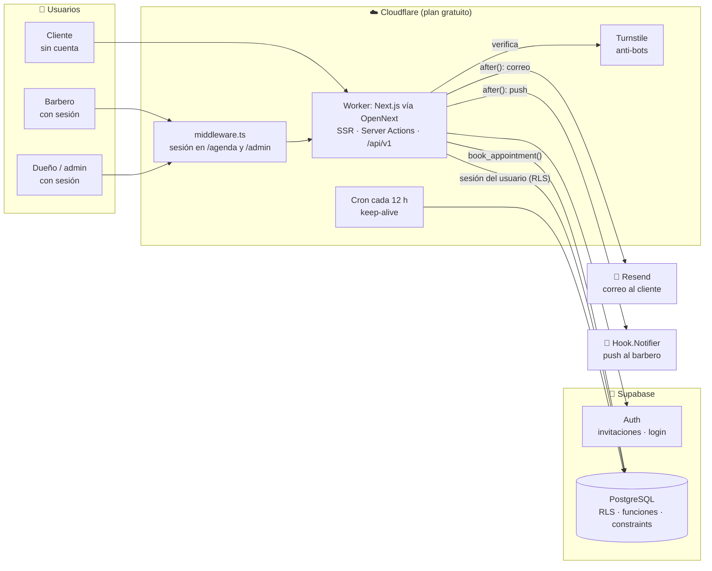

<div align="center">

# ✂️ Urban Styles

**Reservas en línea a la medida de una barbería de barrio.**

Plataforma de agendamiento diseñada, desarrollada y desplegada para la barbería **Urban Styles** (Bogotá): los clientes reservan sin crear cuenta, los barberos manejan su agenda desde el celular y el dueño controla el negocio desde un panel. En producción en [dbarbershopurbanstyles.com](https://dbarbershopurbanstyles.com), con costo de infraestructura de **USD 0/mes**.

[](https://nextjs.org/)
[](https://react.dev/)
[](https://www.typescriptlang.org/)
[](https://supabase.com/)
[](https://workers.cloudflare.com/)
[](https://tailwindcss.com/)
[](https://zod.dev/)
[](https://vitest.dev/)
[](#-estado-actual)

</div>

---

## Tabla de contenidos

- [Sobre el proyecto](#-sobre-el-proyecto)
- [Estado actual](#-estado-actual)
- [Arquitectura](#-arquitectura)
- [Características](#-características)
- [Decisiones de ingeniería](#-decisiones-de-ingeniería)
- [Stack técnico](#-stack-técnico)
- [Estructura del proyecto](#-estructura-del-proyecto)
- [Instalación rápida](#-instalación-rápida)
- [Pruebas](#-pruebas)
- [Despliegue](#-despliegue)
- [Próximos pasos](#-próximos-pasos)

---

## 💈 Sobre el proyecto

Urban Styles es una barbería local que agendaba por WhatsApp y por teléfono: citas que se cruzaban, clientes que no llegaban y un dueño que no sabía cuánto facturaba cada barbero. Este proyecto es la **solución hecha a medida** para ese negocio, construida de punta a punta: levantamiento de requisitos con el dueño, identidad visual, desarrollo full-stack, infraestructura, dominio propio y entrega en producción.

El resultado es una sola aplicación con **tres portales**:

- **Cliente (público, sin cuenta).** Ve la barbería, los precios y el equipo, y reserva en cuatro pasos: servicio → barbero (o "el primero disponible") → día y hora → nombre y correo. Recibe un correo con un enlace privado para ver, **reprogramar** o cancelar su cita.
- **Barbero (`/agenda`).** Su agenda del día y de la semana, citas tomadas por teléfono, cierre de cada cita (atendida / no vino), solicitudes de días libres y avisos push al celular con cada reserva.
- **Dueño (`/admin`).** Métricas del negocio, todas las citas, gestión del equipo, servicios, precios, horarios y aprobación de días libres, con alerta de las citas que chocan.

Pensado para que el negocio crezca sin rehacer nada: la base de datos es **multi-tenant** desde el primer día (cada barbería con su dominio) y la lógica de reservas está aislada para reutilizarla desde un bot de WhatsApp o pagos en línea.

## 📊 Estado actual

**En producción.** La plataforma opera con la barbería real; la infraestructura (dominio, Cloudflare, Supabase y Resend) está a nombre del cliente y el desarrollo sigue como soporte y evolución.

| Módulo | Estado |
|---|---|
| Portal público: landing de la barbería + reserva en cuatro pasos | ✅ Listo |
| Enlace privado de la cita: ver, cancelar y reprogramar (una vez) | ✅ Listo |
| Portal del barbero: agenda, cierre de citas, citas telefónicas, días libres | ✅ Listo |
| Panel del dueño: métricas, citas, equipo, servicios, horarios, solicitudes | ✅ Listo |
| Prevención de doble reserva en la base de datos (probada con concurrencia real) | ✅ Listo |
| Seguridad por roles con Row Level Security en todas las tablas | ✅ Listo |
| Correo de confirmación (Resend) y push al barbero (Hook.Notifier) | ✅ Listo |
| Anti-bots con Cloudflare Turnstile | ✅ Listo |
| API REST `/api/v1` para integraciones | ✅ Listo |
| Identidad visual (logo, paleta, tipografía) | ✅ Listo |
| Dominio propio, correo verificado y despliegue en Cloudflare | ✅ Listo |
| Migración de todas las cuentas al dueño del negocio | ✅ Listo |
| Recordatorios 24 h antes | ⏳ Planeado |
| Pagos en línea y bot de WhatsApp | ⏳ Planeado — el diseño ya los contempla |

## 🏗️ Arquitectura

**Principio clave: la base de datos es la autoridad.** Disponibilidad, reservas y permisos viven en PostgreSQL (funciones PL/pgSQL, constraints y RLS). El código TypeScript solo valida, orquesta y presenta, así que la web, la API y futuros canales aplican exactamente las mismas reglas.



Flujo de una reserva: el cliente solo ve horarios realmente libres → la Server Action valida con Zod y verifica Turnstile → `book_appointment()` revalida el horario dentro de Postgres e inserta la cita → si otro cliente ganó el horario en el mismo milisegundo, la constraint de exclusión lo rechaza y la interfaz ofrece otro → el correo y el push salen **después** de responder, sin hacer esperar al cliente.

El detalle completo (diagrama ER, tabla de políticas RLS, reglas de disponibilidad y máquina de estados de una cita) está en [`docs/arquitectura.md`](docs/arquitectura.md).

## ✨ Características

<table>
<tr>
<td valign="top" width="50%">

### Para el cliente

- Reserva sin registro, en cuatro pasos y pensada para el celular
- Solo se muestran horarios que de verdad se pueden reservar
- Opción "el primero disponible", que reparte la carga entre barberos
- Correo de confirmación con enlace privado para cancelar o reprogramar
- Zona horaria, moneda (COP) y semana a la colombiana

</td>
<td valign="top" width="50%">

### Para el barbero

- Agenda de hoy, próximos 7 días o completa
- Citas tomadas por teléfono o en mostrador con las mismas reglas que la web
- Cierre de cada cita: atendida, no vino o cancelada con motivo
- Solicitud de días libres u horas bloqueadas
- Push al celular con cada reserva, cancelación o reprogramación

</td>
</tr>
<tr>
<td valign="top" width="50%">

### Para el dueño

- Resumen del negocio: ingresos de citas atendidas, cancelaciones, no-shows, servicios más pedidos y desempeño por barbero
- Equipo por invitación, con roles combinables (el dueño también corta)
- Catálogo, precios y horario con varias franjas por día
- Bandeja de días libres que muestra con qué citas choca cada solicitud
- Cambio Barbero / Administración sin cerrar sesión

</td>
<td valign="top" width="50%">

### Bajo el capó

- Doble reserva imposible: constraint de exclusión con 15 min de margen entre citas
- RLS en todas las tablas: un barbero nunca ve las citas de otro
- Tokens de cita guardados como hash; enlaces de correo resistentes a escáneres
- Notificaciones que nunca rompen una reserva, con bitácora de envíos
- Esqueletos de carga, estados vacíos y mensajes de error en español

</td>
</tr>
</table>

## 🧠 Decisiones de ingeniería

- **Integridad en la base de datos, no en el frontend.** `exclude using gist` sobre el rango de cada cita impide solapes incluso con dos transacciones simultáneas; `npm run test:race` lanza N reservas al mismo horario y verifica que gane exactamente una.
- **Privilegio mínimo.** El visitante anónimo no puede llamar `book_appointment`: toda reserva pública pasa por el servidor, donde se verifica Turnstile. El staff solo puede modificar las columnas de estado de una cita; precio, horario y cliente son inmutables. Un trigger garantiza que la barbería nunca se quede sin administrador.
- **Costo cero sin sacrificar calidad.** Next.js corre en un solo Worker de Cloudflare (bundle bajo el límite de 3 MiB del plan gratuito): sin SDKs pesados (Resend y Hook.Notifier por `fetch`), fechas con `Intl` en lugar de librerías y gráficos en HTML/CSS. Un cron mantiene activo el proyecto de Supabase.
- **Listo para crecer.** Multi-tenant por dominio (`barbershops.custom_domain`), lógica de reserva en `lib/domain/` sin dependencias de React ni HTTP, y estado `pending` ya previsto para pagos en línea.
- **Pruebas sobre Postgres real.** PGlite (Postgres en WebAssembly) aplica todas las migraciones en cada prueba: RLS, disponibilidad, estados y aprobaciones se prueban sin Docker.

## 🛠️ Stack técnico

| Categoría | Tecnología |
|---|---|
| **Framework** | Next.js 16 (App Router, Server Components, Server Actions, API Routes) |
| **UI** | React 19, Tailwind CSS 3, primitivas Radix / shadcn/ui, Lucide |
| **Lenguaje y validación** | TypeScript, Zod 4 (esquemas compartidos entre web y API) |
| **Base de datos y auth** | Supabase: PostgreSQL 17, PL/pgSQL, Row Level Security, Auth por invitación |
| **Hosting** | Cloudflare Workers + Static Assets con `@opennextjs/cloudflare`, dominio propio |
| **Correo** | [Resend](https://resend.com/) por API HTTP, dominio verificado (DKIM, SPF, DMARC) |
| **Notificaciones push** | Hook.Notifier (URL personal por barbero) |
| **Anti-bots** | Cloudflare Turnstile |
| **Pruebas** | Vitest + PGlite, prueba de concurrencia contra Supabase |

**Identidad visual:** "letrero esmaltado y baldosa de barbería". Porcelana `#EEF0EB`, verde botella `#16392E` y rojo de poste `#9B2335`, con *Big Shoulders* para rótulos y *Libre Franklin* para texto.

## 📁 Estructura del proyecto

```
urban-styles/
├── app/
│   ├── (public)/              # portal del cliente: landing, reserva y /cita/[token]
│   ├── (staff)/
│   │   ├── agenda/            # portal del barbero (rol barber)
│   │   ├── admin/             # panel del dueño (rol admin)
│   │   └── actions.ts         # Server Actions del equipo
│   ├── api/
│   │   ├── v1/                # API JSON: shop, availability, bookings
│   │   └── health/            # estado del Worker y de Supabase
│   └── auth/                  # login, invitaciones, recuperar contraseña
├── components/
│   ├── booking/               # "tiquete de turno" y selector de día/hora
│   ├── staff/                 # listas, formularios, horarios y gráficos
│   └── ui/                    # primitivas shadcn/ui
├── lib/
│   ├── domain/                # ★ lógica de negocio (sin React ni HTTP)
│   ├── validation/            # esquemas Zod
│   ├── supabase/              # clientes: sesión, navegador, anónimo, servidor
│   ├── email/templates.ts     # correos en HTML compatibles con Gmail y Outlook
│   └── format.ts              # COP, fechas y zonas horarias con Intl
├── supabase/
│   ├── migrations/            # ★ esquema, RLS y funciones (fuente de verdad)
│   └── seed.sql               # datos de ejemplo
├── scripts/                   # create-owner · seed-demo · race-test
├── tests/                     # db/ (Postgres real con PGlite) y unit/
├── docs/                      # arquitectura y guía de operación
├── middleware.ts              # sesión en rutas del equipo
├── worker.ts                  # entrada del Worker + cron keep-alive
└── wrangler.jsonc             # configuración de Cloudflare
```

## 🚀 Instalación rápida

> Requiere Node ≥ 20 y una cuenta gratuita de Supabase. No hace falta Docker.

```bash
# 1. Instalar dependencias
npm install
npm install-scripts approve esbuild unrs-resolver workerd && npm rebuild   # npm ≥ 11

# 2. Variables de entorno
cp .env.example .env.local   # URL y llaves de Supabase, Resend y Turnstile

# 3. Base de datos
npx supabase link --project-ref <ref-del-proyecto>
npm run db:seed              # migraciones + datos de ejemplo

# 4. Cuenta del dueño (roles admin + barber)
npm run create-owner -- --email dueno@ejemplo.co --name "Nombre" --password "una-clave-segura"

# 5. Arrancar
npm run dev                  # http://localhost:3000
npm run preview              # runtime real de Cloudflare en local
```

### Configurar Supabase

En el dashboard: desactivar el registro público (las cuentas solo se crean por invitación), agregar `http://localhost:3000/**` y la URL de producción en *Redirect URLs*, y cambiar el enlace de las plantillas *Invite user* y *Reset password* para que usen `token_hash`:

```
{{ .SiteURL }}/auth/confirm?token_hash={{ .TokenHash }}&type=invite&next=/auth/update-password
{{ .SiteURL }}/auth/confirm?token_hash={{ .TokenHash }}&type=recovery&next=/auth/update-password
```

Se recomienda usar Resend como SMTP de Supabase (`smtp.resend.com:465`, usuario `resend`): el SMTP por defecto solo envía unos pocos correos por hora.

### Variables de entorno

| Variable | Para qué | Tipo |
|---|---|---|
| `NEXT_PUBLIC_SUPABASE_URL` | URL del proyecto Supabase | Pública |
| `NEXT_PUBLIC_SUPABASE_PUBLISHABLE_KEY` | Llave pública, sujeta a RLS | Pública |
| `SUPABASE_SECRET_KEY` | Llave del servidor, **ignora RLS** | **Secreta** |
| `NEXT_PUBLIC_SITE_URL` | URL pública, usada en los enlaces de los correos | Pública |
| `DEFAULT_SHOP_SLUG` | Barbería por defecto si el dominio no coincide | Pública |
| `RESEND_API_KEY` / `EMAIL_FROM` | Envío del correo de confirmación | Secreta / Pública |
| `NEXT_PUBLIC_TURNSTILE_SITE_KEY` / `TURNSTILE_SECRET_KEY` | Anti-bots del formulario | Pública / Secreta |
| `INTEGRATION_API_KEY` | Habilita `POST /api/v1/bookings` (vacía = deshabilitado) | **Secreta** |

Las secretas nunca llevan prefijo `NEXT_PUBLIC_` ni se versionan.

## 🧪 Pruebas

```bash
npm test              # unitarias + base de datos (Postgres real en WASM)
npm run typecheck
npm run lint
npm run test:race     # concurrencia real contra Supabase (solo desarrollo)
```

`tests/db/` aplica todas las migraciones sobre un Postgres limpio por prueba y cubre disponibilidad, reservas, la constraint de exclusión, cancelación y reprogramación por token, aislamiento por rol, aprobación de días libres, transiciones de estado y la protección del último administrador.

## ☁️ Despliegue

Todo corre en **un solo Worker de Cloudflare** que sirve el front estático, el SSR, las Server Actions y la API.

```bash
npx wrangler login                          # una sola vez
npx wrangler secret put SUPABASE_SECRET_KEY
npx wrangler secret put RESEND_API_KEY
npx wrangler secret put TURNSTILE_SECRET_KEY
npm run db:push                             # migraciones contra producción
npm run deploy                              # build con OpenNext + publicación
```

Las variables públicas van en `wrangler.jsonc › vars` y en `.env.production.local` (no versionado), porque `next build` las incrusta en el JavaScript. El dominio se asigna con `routes` en `wrangler.jsonc`. Si el tráfico crece, Workers Paid (USD 5/mes) amplía los límites sin cambiar código.

La guía de uso para el dueño de la barbería y la tabla de solución de problemas están en [`docs/operacion.md`](docs/operacion.md).

## 🗺️ Próximos pasos

- [x] Reserva pública, portal del barbero y panel del dueño
- [x] Reprogramación desde el enlace del correo
- [x] Dominio propio, correo verificado y salida a producción
- [ ] Recordatorios por correo o push 24 h antes (Cron Trigger + `notification_log`)
- [ ] Pagos en línea (Wompi o Mercado Pago): citas `pending` hasta confirmar el pago
- [ ] Bot de WhatsApp sobre `POST /api/v1/bookings`
- [ ] Varias sucursales y alta self-service de nuevas barberías
- [ ] Fotos del equipo en Supabase Storage

---

<div align="center">

Diseñado y desarrollado por [**sebasreino11**](https://github.com/sebasreino11) · ¿Tu negocio necesita algo así? Escríbeme.

Hecho con ▲ Next.js, 🐘 Supabase y ☁️ Cloudflare

</div>
