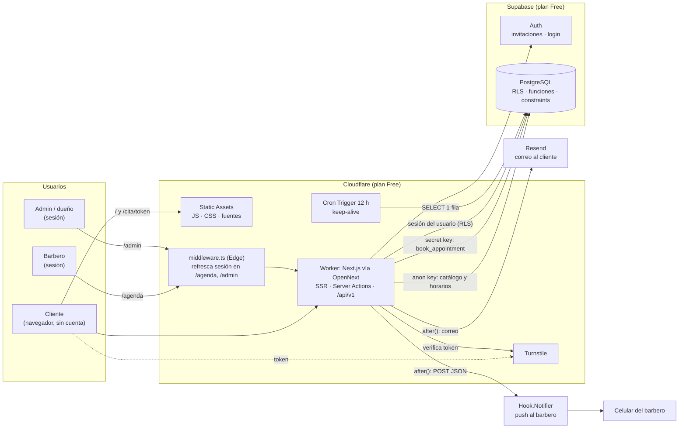
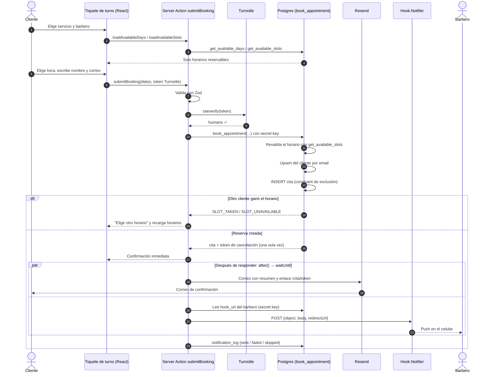
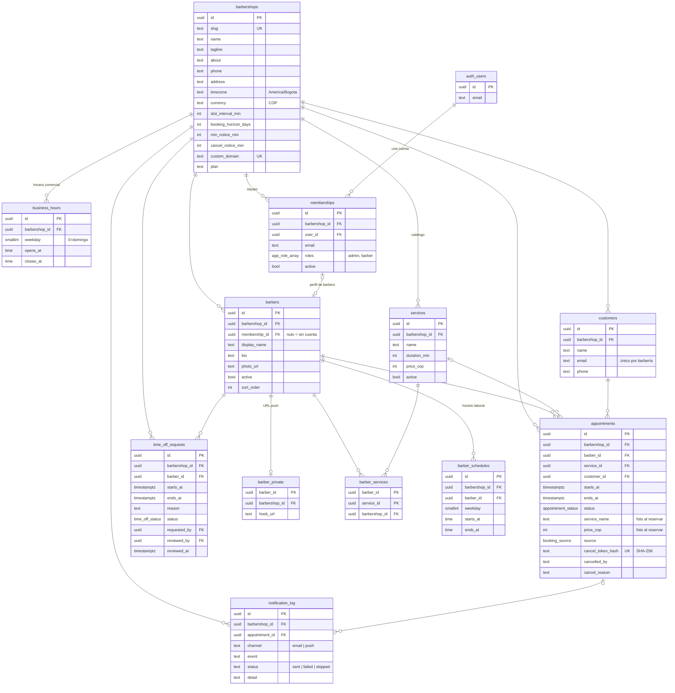
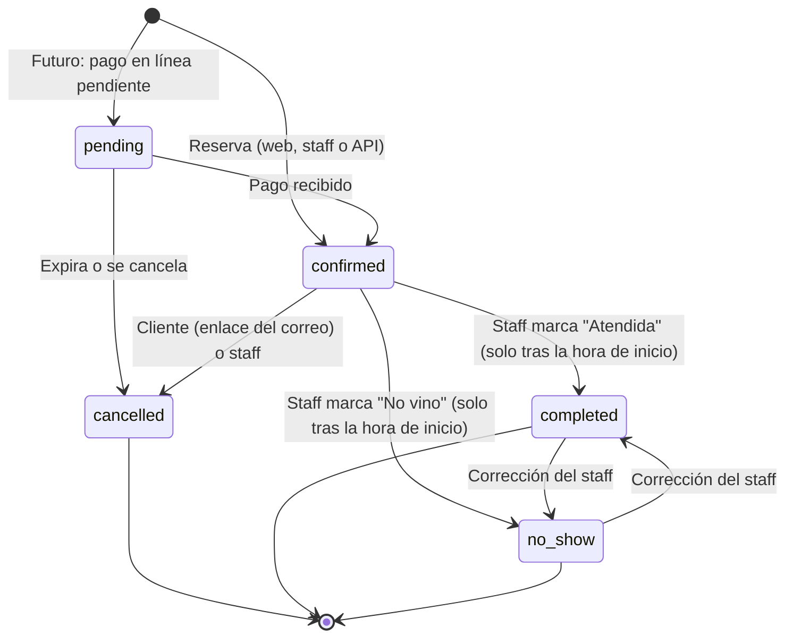
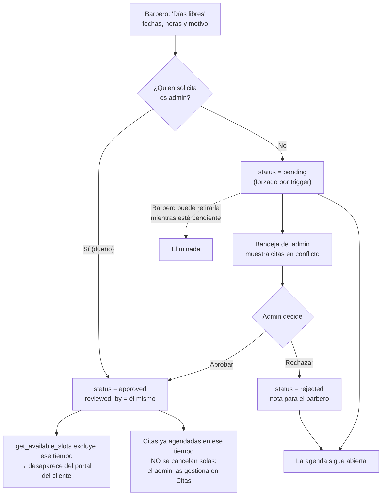

# Urban Styles — Plataforma de reservas para barberías

Producto SaaS multi-barbería para agendar citas en línea. El primer cliente es **Urban Styles** (Bogotá). Los clientes reservan sin crear cuenta, los barberos gestionan su agenda y el dueño administra todo desde un panel, con costo mensual de **USD 0** mientras el volumen esté dentro de los planes gratuitos.

> Este documento sirve tres propósitos: **onboarding** de desarrolladores, **referencia operativa** para el dueño de la barbería (ver [Guía para el dueño](#guía-de-operación-para-el-dueño-de-la-barbería)) y **guía de mantenimiento**.

## Contenido

1. [Descripción del producto](#descripción-del-producto)
2. [Stack técnico](#stack-técnico)
3. [Arquitectura del sistema](#arquitectura-del-sistema)
4. [Modelo de datos](#modelo-de-datos)
5. [Estructura del proyecto](#estructura-del-proyecto)
6. [Configuración del entorno local](#configuración-del-entorno-local)
7. [Variables de entorno](#variables-de-entorno)
8. [Despliegue a producción](#despliegue-a-producción)
9. [Políticas RLS](#políticas-rls)
10. [Reglas de negocio](#reglas-de-negocio)
11. [API para integraciones](#api-para-integraciones)
12. [Pruebas](#pruebas)
13. [Guía de operación para el dueño de la barbería](#guía-de-operación-para-el-dueño-de-la-barbería)
14. [Roadmap futuro](#roadmap-futuro)
15. [Solución de problemas comunes](#solución-de-problemas-comunes)
16. [Mantener este README al día](#mantener-este-readme-al-día)

---

## Descripción del producto

Una sola aplicación sirve **tres portales**. Una misma persona puede tener varios roles con una sola cuenta: el dueño suele ser `admin` y `barber` a la vez.

**Portal del cliente (público, sin cuenta).** En `/` el cliente ve la barbería: quiénes son, el tablero de precios, el equipo, la dirección y el horario. Reserva en cuatro pasos (servicio → barbero o "el primero disponible" → día y hora → nombre y correo). Solo se muestran horarios realmente reservables. Al confirmar recibe un correo con el resumen y un enlace privado (`/cita/<token>`) para ver o cancelar su cita. No hay login, perfil ni historial.

**Portal del barbero (`/agenda`, requiere cuenta).** El barbero ve sus citas de hoy, de los próximos 7 días o todas, con el servicio elegido y el contacto del cliente. Marca citas como atendidas o "no vino" y cancela con motivo. También puede agendar citas telefónicas, **solicitar** días libres u horas bloqueadas (quedan pendientes hasta que el admin las aprueba) y configurar su URL de Hook.Notifier para recibir un push en el celular con cada reserva o cancelación.

**Portal del administrador (`/admin`, rol admin).** Incluye un resumen del negocio (ingresos de citas atendidas, citas agendadas, tasa de cancelación, no-shows, servicios más pedidos, desempeño por barbero), todas las citas de todos los barberos y la bandeja de solicitudes de indisponibilidad, donde se ve con qué citas choca cada solicitud. Desde aquí se gestiona el equipo (invitar, roles, activar o desactivar, servicios y horario de cada barbero), el catálogo de servicios y el perfil y las reglas de reserva de la barbería. Si la cuenta también es barbero, un selector **Barbero / Administración** cambia de vista sin cerrar sesión. Los bloqueos que pide un admin se aprueban automáticamente y queda registrado quién los aprobó.

---

## Stack técnico

| Tecnología | Versión | Rol | Por qué |
|---|---|---|---|
| **Next.js** (App Router) | 16.4.2 | Frontend + backend (Server Components, Server Actions, API Routes) | Un solo proyecto para los tres portales y la lógica de servidor. |
| **React** | 19.3.1 | UI | Requerido por Next 16; `useTransition` para formularios sin librerías extra. |
| **Supabase** (PostgreSQL 17) | supabase-js 2.118 · @supabase/ssr 0.12.7 | Base de datos, Auth, RLS | Postgres real (constraints de exclusión, PL/pgSQL), Auth incluido, plan gratuito generoso. |
| **Cloudflare Workers** + Static Assets | Wrangler 4.151.1 | Hosting de SSR, Server Actions, API y estáticos | Plan gratuito con 100.000 requests/día y sin "cold starts" relevantes. |
| **@opennextjs/cloudflare** | 1.20.12 | Adaptador Next → Workers | Adaptador oficial (reemplaza al deprecado `next-on-pages`). |
| **Resend** | API HTTP (sin SDK) | Correo de confirmación al cliente | 100 correos/día gratis. Se llama con `fetch` para no inflar el bundle. |
| **Hook.Notifier** | API HTTP (sin SDK) | Push al celular del barbero | Gratis, sin cuota; cada barbero pega su URL personal. |
| **Cloudflare Turnstile** | — | Anti-bots en el formulario público | Gratis, sin captchas de imágenes. |
| **Tailwind CSS** | 3.4.19 | Estilos | Tokens de diseño en `app/globals.css`. |
| **Zod** | 4.6.7 | Validación de entrada | Esquemas compartidos entre web y API. |
| **Vitest** + **PGlite** | 5.0.5 · 0.5.10 | Pruebas | PGlite es Postgres en WASM: las pruebas de RLS y disponibilidad corren sin Docker. |

**Identidad visual:** "letrero esmaltado y baldosa de barbería". Fondo porcelana `#EEF0EB`, verde botella `#16392E`, rojo de poste `#9B2335`. Tipografías *Big Shoulders* (rótulos) y *Libre Franklin* (texto).

---

## Arquitectura del sistema

**Principio clave: la base de datos es la autoridad.** La disponibilidad, la reserva y la seguridad viven en PostgreSQL (funciones PL/pgSQL, constraints y RLS). El código TypeScript solo valida la entrada, orquesta y presenta. Así la web, la API y el futuro bot de WhatsApp aplican exactamente las mismas reglas.

### Diagrama de arquitectura general



### Diagrama de flujo de reserva



### Acceso de barberos y admin

1. `middleware.ts` (Edge) corre **solo** en `/agenda/*`, `/admin/*` y `/auth/*`. Refresca la cookie de sesión de Supabase y redirige al login si no hay usuario.
2. `app/(staff)/layout.tsx` llama a `requireStaff()`, que lee la membresía y los roles. `agenda/layout.tsx` exige `barber` y `admin/layout.tsx` exige `admin`.
3. Toda consulta del staff usa el cliente con la **sesión del usuario**, así que RLS decide qué filas ve y modifica. Ocultar botones es solo UX; la seguridad está en la base de datos.

### Por qué `middleware.ts` y no `proxy.ts`

Next 16 renombró el middleware a `proxy.ts` (runtime Node). En OpenNext para Cloudflare ese runtime todavía es *experimental*, mientras que el middleware Edge está soportado de forma estable. Por eso se usa `middleware.ts` y el aviso de deprecación en el build es esperado. Cuando OpenNext estabilice el proxy Node basta con renombrar el archivo y la función.

---

## Modelo de datos

Todas las tablas de negocio llevan `barbershop_id` (multi-tenant). Las FKs compuestas `(id, barbershop_id)` impiden, a nivel de base de datos, mezclar filas de dos barberías (p. ej. una cita de la barbería A con un barbero de la B).



| Tabla | Qué representa |
|---|---|
| `barbershops` | El tenant: perfil público y reglas de reserva (intervalo, horizonte, antelación mínima, antelación para cancelar). |
| `business_hours` | Horario comercial semanal. Admite varias franjas por día, p. ej. cerrar al almuerzo. Una constraint de exclusión impide franjas solapadas. |
| `memberships` | Vincula una cuenta de Supabase Auth con una barbería y un **arreglo de roles** (`{admin,barber}`). Una persona tiene una sola cuenta. |
| `barbers` | Perfil profesional visible al público. `membership_id` nulo significa que el barbero no tiene cuenta (recibe reservas pero no entra al sistema). |
| `barber_private` | URL de Hook.Notifier. Está separada porque `barbers` es legible por el público. |
| `services` | Catálogo. El precio es un entero en COP. Desactivar un servicio lo oculta sin borrar el historial. |
| `barber_services` | Qué servicios hace cada barbero. |
| `barber_schedules` | Horario laboral semanal de cada barbero. |
| `customers` | Contacto del cliente final (nombre, correo, teléfono). Sin login. Se deduplica por correo dentro de cada barbería. |
| `appointments` | Citas. Guardan una "foto" del nombre y precio del servicio, para que editar el catálogo no altere los ingresos históricos. |
| `time_off_requests` | Solicitudes de indisponibilidad. Solo bloquean la agenda cuando `status = 'approved'`. |
| `notification_log` | Rastro de cada correo y push (enviado, fallido u omitido) para diagnosticar. |

Las migraciones están en `supabase/migrations/` y se aplican en orden: esquema → helpers de autorización → RLS → lógica de negocio.

---

## Estructura del proyecto

```
.
├── app/
│   ├── (public)/              Portal del cliente
│   │   ├── page.tsx           Landing + tiquete de reserva
│   │   ├── actions.ts         Server Actions públicas (adaptadores delgados → lib/domain)
│   │   └── cita/[token]/      Ver / cancelar cita desde el enlace del correo
│   ├── (staff)/               Portales con sesión
│   │   ├── layout.tsx         requireStaff() + navegación + selector Barbero/Admin
│   │   ├── actions.ts         Server Actions de barbero y admin
│   │   ├── agenda/            Portal del barbero (exige rol barber)
│   │   └── admin/             Portal del admin (exige rol admin)
│   ├── api/
│   │   ├── v1/                API JSON (shop, availability, bookings) → reutilizable por WhatsApp
│   │   └── health/            Chequeo de Worker + Supabase
│   └── auth/                  Login, recuperar contraseña, aceptar invitación
├── components/
│   ├── booking/               Tiquete de reserva (cliente) + Turnstile
│   ├── staff/                 Piezas de los portales de staff (listas, formularios, gráficos)
│   └── ui/                    Primitivas shadcn/ui
├── lib/
│   ├── domain/                ★ Lógica de negocio reutilizable (sin React ni HTTP)
│   │   ├── booking.ts         Disponibilidad, crear y cancelar reservas
│   │   ├── notifications.ts   Resend + Hook.Notifier + notification_log
│   │   ├── shop.ts            Resolución de tenant por host + catálogo público
│   │   ├── staff.ts           Contexto de sesión/roles y consultas del staff
│   │   └── errors.ts          Códigos de error de la BD → mensajes en español
│   ├── validation/            Esquemas Zod (web y API comparten los mismos)
│   ├── supabase/              Clientes: server (sesión), client (navegador), anon, admin (secret key)
│   ├── email/templates.ts     HTML del correo de confirmación
│   └── format.ts              COP, fechas y zonas horarias con Intl
├── supabase/
│   ├── migrations/            ★ Esquema, RLS y funciones (fuente de verdad)
│   ├── seed.sql               Datos demo de Urban Styles
│   └── config.toml            Config del CLI (signup público deshabilitado)
├── scripts/                   create-owner (bootstrap) · race-test (concurrencia real)
├── tests/
│   ├── db/                    RLS, disponibilidad y reservas sobre Postgres real (PGlite)
│   └── unit/                  Formato, zonas horarias, validación
├── middleware.ts              Sesión en rutas de staff (Edge)
├── worker.ts                  Entrada del Worker: OpenNext + Cron keep-alive
├── wrangler.jsonc             Config de Cloudflare
└── open-next.config.ts        Config del adaptador
```

**Regla para extender:** la lógica nueva va en `lib/domain/` (o en SQL si es una regla que debe ser atómica o segura). `app/**/actions.ts` y `app/api/**` solo validan, autentican y delegan.

---

## Configuración del entorno local

Requisitos: **Node ≥ 20** (probado con Node 26), una cuenta gratuita de **Supabase** y, para desplegar, una de **Cloudflare**. No hace falta Docker.

```bash
# 1. Clonar e instalar
git clone <repo> urban-styles && cd urban-styles
npm install
# npm ≥ 11 bloquea scripts de instalación: aprueba los de las herramientas de build
npm install-scripts approve esbuild unrs-resolver workerd && npm rebuild

# 2. Variables de entorno
cp .env.example .env.local
# completa NEXT_PUBLIC_SUPABASE_URL, NEXT_PUBLIC_SUPABASE_PUBLISHABLE_KEY y SUPABASE_SECRET_KEY
```

### 3. Configurar Supabase (remoto)

Recomendado: dos proyectos gratuitos, `urban-styles-dev` y `urban-styles-prod`.

```bash
npx supabase login
npx supabase link --project-ref <ref-del-proyecto>   # pide la contraseña de la BD
npm run db:push        # aplica supabase/migrations
npm run db:seed        # aplica migraciones + seed demo (idempotente)
```

> **Supabase local** (opcional, requiere Docker): `npx supabase start` levanta todo y aplica migraciones y seed. Usa las URLs y llaves que imprime en `.env.local`.

En el **dashboard de Supabase**:

1. **Authentication › Sign In / Providers**: desactiva *Allow new users to sign up*. Las cuentas solo se crean por invitación.
2. **Authentication › URL Configuration**: *Site URL* = la URL pública. Agrega `http://localhost:3000/**` y la URL de producción en *Redirect URLs*.
3. **Authentication › Email Templates**: cambia el enlace de estas plantillas.
   - *Invite user*: `{{ .SiteURL }}/auth/confirm?token_hash={{ .TokenHash }}&type=invite&next=/auth/update-password`
   - *Reset password*: `{{ .SiteURL }}/auth/confirm?token_hash={{ .TokenHash }}&type=recovery&next=/auth/update-password`
4. **Authentication › SMTP Settings** (recomendado): usa Resend como SMTP (`smtp.resend.com`, puerto 465, usuario `resend`, contraseña = API key). El SMTP por defecto de Supabase solo envía unos pocos correos por hora.

### 4. Crear la cuenta del dueño

```bash
npm run create-owner -- --email dueno@urbanstyles.co --name "Andrés Gómez" --password "una-clave-segura"
# Para vincular al dueño con un barbero demo existente:
#   ... --barber-id 00000000-0000-4000-c000-000000000003
```

Esto crea **una** cuenta con roles `admin` + `barber`, su perfil de barbero, sus servicios y su horario (copiado del horario comercial).

### 5. Iniciar

```bash
npm run dev            # http://localhost:3000  (Node, recarga en caliente)
npm run preview        # build de Workers + runtime real de Cloudflare en local (usa .dev.vars)
```

---

## Variables de entorno

| Variable | Qué es | De dónde sale | Tipo |
|---|---|---|---|
| `NEXT_PUBLIC_SUPABASE_URL` | URL del proyecto Supabase | Supabase › Project Settings › API | Pública |
| `NEXT_PUBLIC_SUPABASE_PUBLISHABLE_KEY` | Llave pública (`sb_publishable_…`), sujeta a RLS | Supabase › Project Settings › API Keys | Pública |
| `SUPABASE_SECRET_KEY` | Llave secreta (`sb_secret_…`), **ignora RLS** | Supabase › Project Settings › API Keys | **Secreta** |
| `NEXT_PUBLIC_SITE_URL` | URL pública, usada en enlaces de correos | Tu dominio o `*.workers.dev` | Pública |
| `DEFAULT_SHOP_SLUG` | Barbería por defecto si el dominio no coincide con ninguna | `barbershops.slug` | Pública |
| `RESEND_API_KEY` | API key de Resend | resend.com › API Keys | **Secreta** |
| `EMAIL_FROM` | Remitente, p. ej. `Urban Styles <citas@urbanstyles.co>` | Dominio verificado en Resend | Pública |
| `NEXT_PUBLIC_TURNSTILE_SITE_KEY` | Site key de Turnstile | Cloudflare › Turnstile | Pública |
| `TURNSTILE_SECRET_KEY` | Secret key de Turnstile | Cloudflare › Turnstile | **Secreta** |
| `INTEGRATION_API_KEY` | Habilita `POST /api/v1/bookings` (vacía = deshabilitado) | Genérala con `openssl rand -hex 32` | **Secreta** |

Las variables `NEXT_PUBLIC_*` se incrustan en el JavaScript del navegador **en build**. En Cloudflare también deben existir en el Worker para el servidor y el cron.

---

## Despliegue a producción

Todo corre en **un solo Worker** con Workers Static Assets (el equivalente actual de "Pages + Workers", con el mismo plan gratuito).

```bash
# 1. Autenticarse en Cloudflare (una vez)
npx wrangler login

# 2. Secretos del Worker (una vez por secreto)
npx wrangler secret put SUPABASE_SECRET_KEY
npx wrangler secret put RESEND_API_KEY
npx wrangler secret put TURNSTILE_SECRET_KEY
npx wrangler secret put INTEGRATION_API_KEY        # opcional

# 3. Variables públicas: en wrangler.jsonc › vars (o en el dashboard)
#    NEXT_PUBLIC_SUPABASE_URL, NEXT_PUBLIC_SUPABASE_PUBLISHABLE_KEY,
#    NEXT_PUBLIC_SITE_URL, NEXT_PUBLIC_TURNSTILE_SITE_KEY, EMAIL_FROM, DEFAULT_SHOP_SLUG
#    Deben existir también en tu shell/.env.local al hacer build (se incrustan en el JS).

# 4. Migraciones contra el proyecto de producción
npx supabase link --project-ref <ref-prod> && npm run db:push

# 5. Build + deploy
npm run deploy
```

El Worker queda en `https://urban-styles.<tu-subdominio>.workers.dev` (`workers_dev: true` en `wrangler.jsonc`). Ajusta `NEXT_PUBLIC_SITE_URL` y las *Redirect URLs* de Supabase a esa URL.

**Checklist antes de mostrar la demo:**

- [ ] Secretos cargados: `SUPABASE_SECRET_KEY` y `TURNSTILE_SECRET_KEY`. **Sin el secreto de Turnstile no hay protección anti-bots**: `lib/turnstile.ts` la omite.
- [ ] Supabase Auth configurado (Site URL, Redirect URLs, plantillas con `token_hash`, registros desactivados). Ver [Configurar Supabase](#3-configurar-supabase-remoto).
- [ ] `npm run db:seed` + `npm run create-owner`.
- [ ] `npm run seed-demo`: 4 semanas de historial y 10 días de agenda con clientes ficticios (`@demo.example.com`), sin enviar correos. `-- --reset` recarga y `-- --remove` borra solo las citas demo (hazlo antes de entregar al cliente).
- [ ] Con `EMAIL_FROM = onboarding@resend.dev`, Resend **solo envía al correo del dueño de la cuenta Resend**. Para probar el correo de confirmación, reserva con ese correo.
- [ ] Recorrido completo: reservar → correo → cancelar por enlace → panel (estados, indisponibilidad, métricas).

**Archivos de configuración:**

- `wrangler.jsonc`: nombre del Worker, `main: worker.ts`, flags `nodejs_compat`, assets, cron `0 */12 * * *` y `vars`.
- `open-next.config.ts`: sin caché incremental (no hay ISR, así que no se necesita R2, que exige tarjeta).
- `worker.ts`: envuelve el handler de OpenNext y añade el `scheduled()` de keep-alive.

**Dominio propio** (después de la venta):

1. Compra el dominio y agrégalo como zona en Cloudflare.
2. Workers & Pages › `urban-styles` › Settings › Domains & Routes › *Add Custom Domain* (`urbanstyles.co`).
3. `update barbershops set custom_domain = 'urbanstyles.co' where slug = 'urban-styles';` Con esto el mismo despliegue puede servir varias barberías, cada una con su dominio.
4. Actualiza `NEXT_PUBLIC_SITE_URL`, las *Redirect URLs* de Supabase y verifica el dominio en Resend para cambiar `EMAIL_FROM`.
5. Pon `"workers_dev": false` en `wrangler.jsonc` para que deje de existir la URL de workers.dev.
6. Configura SMTP propio en Supabase (Resend) y el largo mínimo de contraseña en 8.
7. Reemplaza los datos ficticios del seed (teléfonos, dirección, Instagram, barberos demo) por los reales desde el panel admin, y borra las citas demo con `npm run seed-demo -- --remove`.

**Límites del plan Free y plan B:** el Worker pesa ~1,8 MiB comprimido (límite 3 MiB) y el plan Free da 10 ms de CPU por request. Si el volumen o el CPU crecen, **Workers Paid cuesta USD 5/mes** (10 M requests, 30 s de CPU) y no requiere cambios de código.

---

## Políticas RLS

RLS está **activo en todas las tablas** y nada es accesible por defecto. Roles de Postgres:

- `anon`: visitante sin sesión (portal público).
- `authenticated`: staff con sesión. Lo que puede hacer depende de `memberships.roles`.
- `service_role`: el servidor con la secret key. Ignora RLS y solo se usa para operaciones públicas ya validadas (reservar, cancelar por token), para leer la URL de push y para escribir `notification_log`.

Helpers (`SECURITY DEFINER`, evitan recursión): `has_role(shop, role?)`, `is_admin(shop)`, `my_barber_ids()`.

| Tabla | anon | Barbero | Admin |
|---|---|---|---|
| `barbershops` | Leer | Leer | Leer, editar la suya |
| `business_hours` | Leer | Leer | Todo (su barbería) |
| `memberships` | — | Leer la propia | Todo (su barbería) |
| `barbers` | Leer activos | Leer los de su barbería | Todo |
| `barber_private` | — | Leer/editar **la suya** | Todo |
| `services` | Leer activos | Leer los de su barbería | Todo |
| `barber_services` | Leer | Leer | Todo |
| `barber_schedules` | — | Leer (su barbería) | Todo |
| `customers` | — | Leer **solo clientes con citas suyas** | Leer y editar |
| `appointments` | — | Leer y cambiar estado **solo de sus citas** | Leer y cambiar estado de todas |
| `time_off_requests` | — | Leer las suyas; crear **para sí mismo** (forzado a `pending`); retirar las pendientes | Todo; aprobar o rechazar |
| `notification_log` | — | — | Leer |

**Defensas adicionales, además de RLS:**

- `appointments`: no hay política INSERT. Las citas solo nacen en `book_appointment()`. El staff solo tiene `GRANT UPDATE (status, cancel_reason, staff_note)`, así que horario, barbero, cliente y precio no se pueden alterar.
- `time_off_enforce_status` (trigger): si quien inserta no es admin, la solicitud queda `pending` aunque se envíe `approved`. Si es admin, se aprueba sola con `reviewed_by` = él mismo. En UPDATE impide reasignar barbero o barbería.
- `appointments_guard_status` (trigger): solo permite transiciones válidas. Impide cerrar como atendida una cita futura.
- `memberships_keep_admin` (trigger diferido): la barbería nunca se queda sin un admin activo (`LAST_ADMIN`).

**Funciones y quién puede ejecutarlas:**

| Función | anon | authenticated | service_role |
|---|---|---|---|
| `get_available_slots`, `get_available_days` | ✓ | ✓ | ✓ |
| `book_appointment` | ✗ | ✓ (solo staff de esa barbería) | ✓ |
| `get_appointment_by_token`, `cancel_appointment_by_token` | ✗ | ✗ | ✓ |
| `time_off_conflicts`, `replace_weekly_hours`, `shop_insights` | ✗ | ✓ (las dos últimas exigen admin) | ✓ |

Que anon no pueda llamar `book_appointment` obliga a que toda reserva pública pase por el servidor, donde se verifica Turnstile. Ni con la publishable key se puede reservar en masa directamente contra Supabase.

Todo esto está cubierto por `tests/db/rls.test.ts`.

---

## Reglas de negocio

### Cálculo de disponibilidad (`get_available_slots`)

Un horario de inicio es reservable para un barbero si **todas** estas condiciones se cumplen:

1. Cae en la **intersección** del horario comercial (`business_hours`) y el horario laboral del barbero (`barber_schedules`) de ese día de la semana.
2. **El servicio completo cabe** antes del final de esa franja (un corte de 45 min en una franja que cierra a las 18:00 empieza como tarde a las 17:15).
3. Los inicios se generan cada `slot_interval_min` (15 min por defecto) desde el comienzo de la franja.
4. Respeta la **antelación mínima** (`min_notice_min`) y el **horizonte** (`booking_horizon_days`). No se ofrecen fechas pasadas.
5. No se **solapa** con citas `pending` o `confirmed` del barbero. Se compara el intervalo completo, no solo la hora de inicio, y cada cita lleva **15 min de tiempo muerto** al final: se compara `[inicio, fin + 15 min)` (función `appt_blocked_range`). La cita conserva su `ends_at` real.
6. No se solapa con indisponibilidad **aprobada**. Las solicitudes pendientes o rechazadas no bloquean nada.
7. El barbero está activo y realiza ese servicio.

Con "el primero disponible" (`p_barber = null`) se devuelven los horarios donde **algún** barbero está libre, junto con la lista de barberos libres. Todas las horas se calculan en la zona horaria de la barbería (`America/Bogota`) y se guardan como `timestamptz`.

### Prevención de doble reserva

Funciona en tres capas, y la última es infalible:

1. **UI:** solo muestra horarios libres y recarga si el horario se ocupa.
2. **`book_appointment` revalida** el horario con la misma `get_available_slots`. Nunca confía en lo que envía el cliente.
3. **Constraint de exclusión** en `appointments`:
   ```sql
   exclude using gist (barber_id with =, public.appt_blocked_range(starts_at, ends_at) with &&)
     where (status in ('pending','confirmed'))
   ```
   `appt_blocked_range` incluye los 15 min de tiempo muerto, así que la BD también impide citas pegadas.
   Postgres rechaza (`23P01`) cualquier cita activa que se solape con otra del mismo barbero, aunque dos transacciones lleguen en el mismo milisegundo. Con "el primero disponible", la función atrapa el error y prueba al siguiente barbero libre (empezando por el que tiene menos citas ese día). Si no queda ninguno responde `SLOT_TAKEN`. Verificado con `npm run test:race`.

### Estados de una cita



- Las citas nacen `confirmed`. `pending` queda reservado para pagos en línea.
- El cliente cancela con su enlace hasta `cancel_notice_min` antes (2 h por defecto). Después ve el teléfono de la barbería.
- `cancelled`, `pending` y `confirmed` liberan o bloquean el horario según la constraint. `cancelled` es final.

### Aprobación de indisponibilidad



---

## API para integraciones

Base: `/api/v1`. Respuestas JSON y errores `{ error: { code, message } }`.

| Método | Ruta | Auth | Descripción |
|---|---|---|---|
| GET | `/api/v1/shop` | — | Perfil, servicios, barberos y horario |
| GET | `/api/v1/availability?serviceId&date[&barberId]` | — | Horarios libres de un día |
| GET | `/api/v1/availability?serviceId&from&to[&barberId]` | — | Días con disponibilidad |
| POST | `/api/v1/bookings` | `Bearer INTEGRATION_API_KEY` | Crea una cita (`source: "whatsapp"` opcional) |
| GET | `/api/health` | — | Estado del Worker y de Supabase |

El futuro bot de WhatsApp debe recibir el webhook del proveedor, verificar su firma y llamar `createBooking(shopId, input, "whatsapp")` de `lib/domain/booking.ts` (o este endpoint). Usará las mismas reglas y notificaciones sin duplicar código.

---

## Pruebas

```bash
npm test              # unitarias + BD (Postgres real en WASM con PGlite, sin Docker)
npm run typecheck
npm run lint
npm run test:race     # concurrencia REAL contra el Supabase de .env.local (¡solo dev!)
```

`tests/db/` aplica todas las migraciones y el seed sobre un Postgres limpio por test, con un stub mínimo del entorno de Supabase (`tests/db/supabase-stub.sql`: roles, `auth.uid()`). Cubre la disponibilidad, la reserva, la constraint de exclusión, la cancelación por token, el aislamiento de datos por rol, el flujo de aprobación, las transiciones de estado, la protección del último admin y los insights.

---

## Guía de operación para el dueño de la barbería

*Esta sección es para quien maneja la barbería. No necesitas saber programar.*

**Entrar.** Ve a la página de tu barbería, baja hasta el final y toca **"Acceso para el equipo"**. Entra con tu correo y contraseña. Como eres dueño y barbero, arriba a la derecha verás **Barbero | Administración** para pasar de tu agenda al panel del negocio.

**Agregar un barbero.**
1. Administración › **Equipo** › "Invitar al equipo".
2. Escribe su nombre y correo y marca **Barbero** (y **Administrador** solo si debe controlar todo).
3. Le llegará un correo para crear su contraseña.
4. Abre su nombre en la lista para elegir **qué servicios hace** y definir **su horario de trabajo**. Hasta que tenga horario no aparecerán horarios suyos para reservar.
5. Para que alguien deje de recibir reservas, desmarca "Visible y reservable". Para que no pueda entrar más, desmarca "Puede iniciar sesión". Su historial se conserva.

**Definir servicios y precios.** Administración › **Servicios**. Toca *Editar* para cambiar nombre, duración o precio, u *Ocultar* para retirarlo del portal. La **duración** es importante: es el tiempo que la cita bloquea en la agenda. Cambiar un precio no cambia las citas ya agendadas.

**Horario y datos de la barbería.** Administración › **Barbería**. Aquí cambias la dirección, el teléfono, el texto de "La casa" y el **horario de atención**, que admite varias franjas por día (por ejemplo, cerrar al almuerzo). También ajustas las reglas: cada cuántos minutos se ofrecen horarios, con cuántos días de anticipación se puede reservar y hasta cuándo puede cancelar el cliente.

**Aprobar días libres.** Cuando un barbero pide un día libre aparece un número rojo en **Solicitudes**. Verás las fechas, el motivo y si ya tiene citas agendadas en ese tiempo. *Aprobar* cierra su agenda en esas horas, pero **no cancela las citas que ya existían**: revísalas en **Citas**. *Rechazar* deja su agenda abierta, y puedes escribirle una nota. Tus propios bloqueos se aplican de una vez.

**Citas por teléfono.** **Agendar cita** (en tu agenda o en Administración › Citas). El cliente recibe el mismo correo de confirmación.

**Cerrar el día.** Al terminar cada cita, márcala como **Atendida** o **No vino**. Así los ingresos y la tasa de inasistencia salen exactos. En **Citas › Sin cerrar** ves las pendientes de marcar.

**Leer el Resumen.**
- **Ingresos (atendidas):** dinero de las citas marcadas como atendidas en el periodo. Es un estimado según los precios del sistema, no lo que entró a caja.
- **Citas agendadas:** reservas del periodo sin contar las canceladas.
- **Tasa de cancelación:** de cada 100 reservas, cuántas se cancelaron. Si sube, revisa la antelación para cancelar.
- **No asistieron:** de las citas ya cerradas, cuántas fueron "No vino".
- **Servicios más pedidos** y **Por barbero:** qué se vende más y quién atiende más.
- **Próximos 7 días:** citas confirmadas e ingreso esperado.

**Avisos al celular.** Cada barbero entra a *Avisos al celular*, instala la app gratuita **Hook.Notifier**, pega su URL personal y toca *Enviar prueba*.

---

## Roadmap futuro

Planeado pero **no implementado**. El diseño ya deja el terreno listo:

- **Pagos en línea** (Wompi o Mercado Pago para Colombia): las citas nacerían `pending` y pasarían a `confirmed` con el webhook de pago (el estado ya existe en el enum). Agregar tabla `payments` y un job que libere los `pending` vencidos.
- **Bot de WhatsApp:** webhook → `lib/domain/booking.ts` (ya aislado) o `POST /api/v1/bookings`. Está reservado `source = 'whatsapp'`.
- **Múltiples sucursales:** nueva tabla `locations` (FK a `barbershops`) y `location_id` en horarios, barberos y citas. `getStaffContext()` elegiría la membresía o sucursal activa con una cookie.
- **Planes de suscripción** del SaaS: la columna `barbershops.plan` ya existe. Faltan los límites por plan (barberos, recordatorios) y la facturación.
- **Recordatorios** por correo o push 24 h antes, con Cron Trigger y `notification_log` para no duplicar.
- **Reprogramar** una cita desde el enlace del cliente (hoy se cancela y se vuelve a reservar).
- **Onboarding self-service** de nuevas barberías (hoy se crean por SQL + `create-owner`).
- **Fotos** subidas a Supabase Storage (hoy son URLs).

---

## Solución de problemas comunes

| Síntoma | Causa probable | Solución |
|---|---|---|
| La página carga pero no hay servicios ni horarios; `/api/health` responde 503 | **Supabase pausó el proyecto** por 7 días sin actividad (plan Free) | Dashboard de Supabase › *Restore project*. Verifica que el Cron Trigger esté activo (Workers › urban-styles › Triggers) y que el Worker tenga `NEXT_PUBLIC_SUPABASE_URL` y `NEXT_PUBLIC_SUPABASE_PUBLISHABLE_KEY` como vars. |
| Error 1102 / "Worker exceeded CPU time limit" | Plan Free: 10 ms de CPU por request | Revisa en *Observability* qué ruta lo provoca. Si es tráfico real, pasa a **Workers Paid (USD 5/mes)**; no requiere cambios de código. |
| `wrangler deploy` falla por tamaño ("exceeds 3 MiB") | Una dependencia nueva infló el bundle | `npx wrangler deploy --dry-run` muestra el tamaño. Evita SDKs pesados (usa `fetch`) o pasa a Workers Paid (10 MiB). |
| El cliente no recibe el correo | Falta `RESEND_API_KEY`, o el remitente `onboarding@resend.dev` (sin dominio verificado) solo entrega a tu propio correo, o se superaron 100/día | Revisa `notification_log` (status y detalle) y resend.com › Logs. Verifica tu dominio en Resend y cambia `EMAIL_FROM`. |
| El barbero no recibe el push | No configuró su URL, la URL está mal o la app no tiene permiso de notificaciones | `notification_log` mostrará `skipped` o `failed`. Pídele usar *Enviar prueba* en "Avisos al celular". |
| "Ese horario ya no está disponible" al reservar | Otro cliente lo tomó o cambió la configuración | Comportamiento esperado: la BD lo impidió. El portal recarga los horarios. |
| No aparecen horarios para un barbero | No tiene horario laboral, no tiene el servicio asignado, está oculto, no coincide con el horario comercial o tiene un bloqueo aprobado | Administración › Equipo › (barbero): revisa servicios, horario y "Visible". |
| La invitación lleva a "Enlace no válido" | Plantilla de correo sin `token_hash`, URL no permitida o enlace ya usado o expirado | Configura las plantillas y Redirect URLs (ver [Configurar Supabase](#3-configurar-supabase-remoto)). Reenvía la invitación o usa "¿La olvidaste?". |
| "Tu cuenta no tiene acceso activo" al entrar | La cuenta existe en Auth pero no tiene membresía activa | El admin debe activarla en Equipo, o usa `create-owner` para el primer dueño. |
| Las invitaciones dejan de enviarse | Límite del SMTP por defecto de Supabase | Configura Resend como SMTP en Supabase. |
| El formulario dice "No pudimos verificar que eres humano" | Turnstile mal configurado (dominio no agregado o llaves de otro sitio) | Cloudflare › Turnstile › agrega el dominio y revisa las llaves. |
| En `npm install`, el build falla con `workerd`/`esbuild` sin binario | npm ≥ 11 bloqueó sus scripts de instalación | `npm install-scripts approve esbuild unrs-resolver workerd && npm rebuild` |

---

## Mantener este README al día

Este README es parte del código. **Todo cambio que toque alguno de estos puntos debe actualizarlo en el mismo commit o PR:**

- Nueva tabla o columna relevante → *Modelo de datos* (diagrama ER y tabla).
- Nueva política RLS, grant o función de seguridad → *Políticas RLS*.
- Cambio en disponibilidad, reservas, estados o aprobaciones → *Reglas de negocio* y sus diagramas.
- Nuevo servicio externo o variable de entorno → *Stack*, *Variables de entorno*, `.env.example` y `.dev.vars.example`.
- Nueva pantalla o flujo para el dueño → *Guía de operación*.
- Funcionalidad del roadmap implementada → muévela fuera de *Roadmap futuro*.

Si un revisor encuentra un cambio sin su actualización de README, el PR no está listo.
