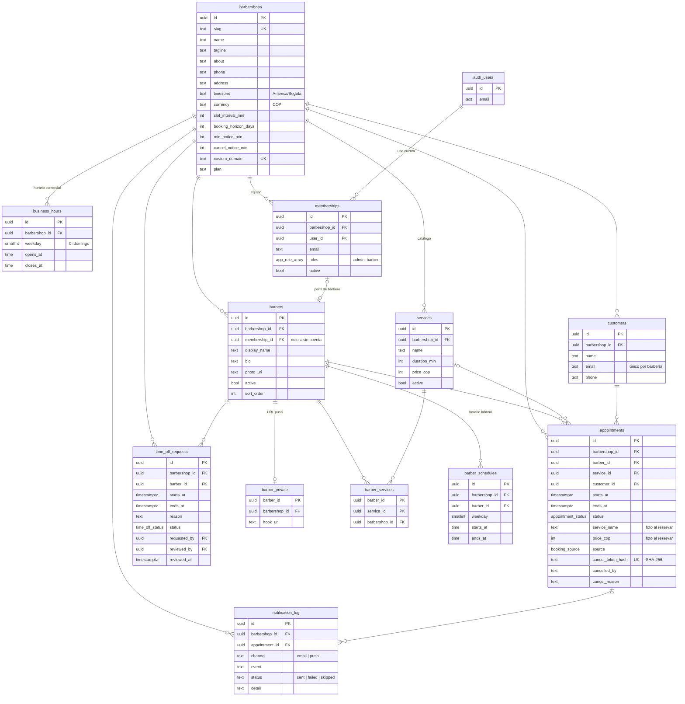
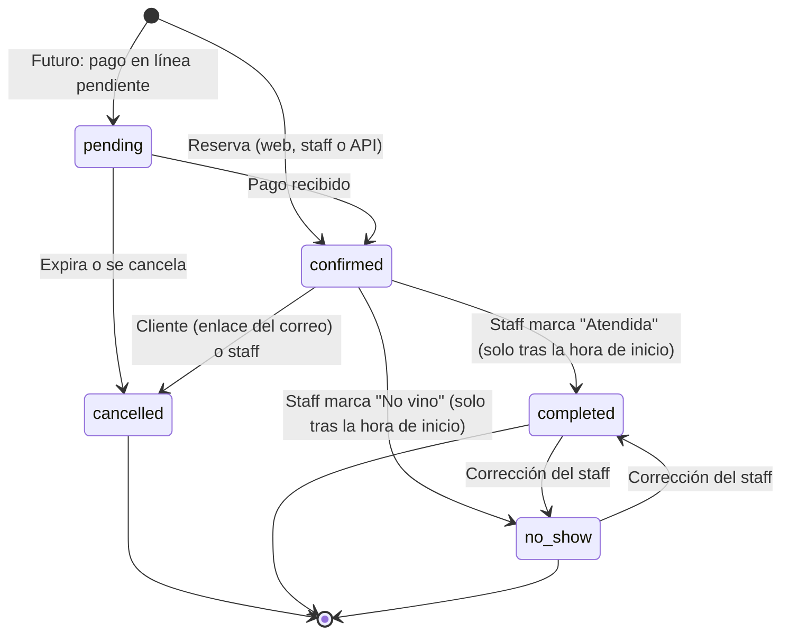
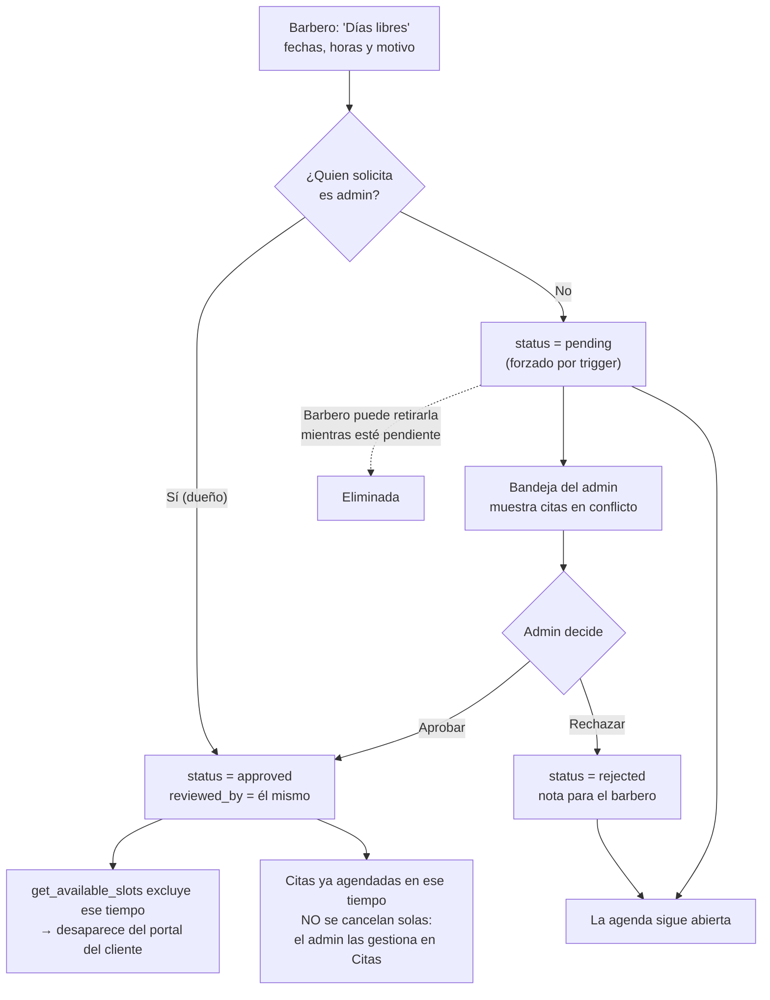

# Arquitectura y reglas de negocio

Documentación técnica de Urban Styles: modelo de datos, seguridad a nivel de fila, reglas de agenda y API. Para la visión general, ver el [README](../README.md).

## Modelo de datos

Todas las tablas de negocio llevan `barbershop_id` (multi-tenant). Las FKs compuestas `(id, barbershop_id)` impiden, a nivel de base de datos, mezclar filas de dos barberías (p. ej. una cita de la barbería A con un barbero de la B).



| Tabla | Qué representa |
|---|---|
| `barbershops` | El tenant: perfil público y reglas de reserva (intervalo, horizonte, antelación mínima, antelación para cancelar). |
| `business_hours` | Horario comercial semanal. Admite varias franjas por día, p. ej. cerrar al almuerzo. Una constraint de exclusión impide franjas solapadas. |
| `memberships` | Vincula una cuenta de Supabase Auth con una barbería y un **arreglo de roles** (`{admin,barber}`). Una persona tiene una sola cuenta. |
| `barbers` | Perfil profesional visible al público. `membership_id` nulo significa que el barbero no tiene cuenta (recibe reservas pero no entra al sistema). |
| `barber_private` | URL de Hook.Notifier. Está separada porque `barbers` es legible por el público. |
| `services` | Catálogo. El precio es un entero en COP. Desactivar un servicio lo oculta sin borrar el historial. |
| `barber_services` | Qué servicios hace cada barbero. |
| `barber_schedules` | Horario laboral semanal de cada barbero. |
| `customers` | Contacto del cliente final (nombre, correo, teléfono). Sin login. Se deduplica por correo dentro de cada barbería. |
| `appointments` | Citas. Guardan una "foto" del nombre y precio del servicio, para que editar el catálogo no altere los ingresos históricos. |
| `time_off_requests` | Solicitudes de indisponibilidad. Solo bloquean la agenda cuando `status = 'approved'`. |
| `notification_log` | Rastro de cada correo y push (enviado, fallido u omitido) para diagnosticar. |

Las migraciones están en `supabase/migrations/` y se aplican en orden: esquema → helpers de autorización → RLS → lógica de negocio.

---


## Políticas RLS

RLS está **activo en todas las tablas** y nada es accesible por defecto. Roles de Postgres:

- `anon`: visitante sin sesión (portal público).
- `authenticated`: staff con sesión. Lo que puede hacer depende de `memberships.roles`.
- `service_role`: el servidor con la secret key. Ignora RLS y solo se usa para operaciones públicas ya validadas (reservar, cancelar por token), para leer la URL de push y para escribir `notification_log`.

Helpers (`SECURITY DEFINER`, evitan recursión): `has_role(shop, role?)`, `is_admin(shop)`, `my_barber_ids()`.

| Tabla | anon | Barbero | Admin |
|---|---|---|---|
| `barbershops` | Leer | Leer | Leer, editar la suya |
| `business_hours` | Leer | Leer | Todo (su barbería) |
| `memberships` | — | Leer la propia | Todo (su barbería) |
| `barbers` | Leer activos | Leer los de su barbería | Todo |
| `barber_private` | — | Leer/editar **la suya** | Todo |
| `services` | Leer activos | Leer los de su barbería | Todo |
| `barber_services` | Leer | Leer | Todo |
| `barber_schedules` | — | Leer (su barbería) | Todo |
| `customers` | — | Leer **solo clientes con citas suyas** | Leer y editar |
| `appointments` | — | Leer y cambiar estado **solo de sus citas** | Leer y cambiar estado de todas |
| `time_off_requests` | — | Leer las suyas; crear **para sí mismo** (forzado a `pending`); retirar las pendientes | Todo; aprobar o rechazar |
| `notification_log` | — | — | Leer |

**Defensas adicionales, además de RLS:**

- `appointments`: no hay política INSERT. Las citas solo nacen en `book_appointment()`. El staff solo tiene `GRANT UPDATE (status, cancel_reason, staff_note)`, así que horario, barbero, cliente y precio no se pueden alterar.
- `time_off_enforce_status` (trigger): si quien inserta no es admin, la solicitud queda `pending` aunque se envíe `approved`. Si es admin, se aprueba sola con `reviewed_by` = él mismo. En UPDATE impide reasignar barbero o barbería.
- `appointments_guard_status` (trigger): solo permite transiciones válidas. Impide cerrar como atendida una cita futura.
- `memberships_keep_admin` (trigger diferido): la barbería nunca se queda sin un admin activo (`LAST_ADMIN`).

**Funciones y quién puede ejecutarlas:**

| Función | anon | authenticated | service_role |
|---|---|---|---|
| `get_available_slots`, `get_available_days` | ✓ | ✓ | ✓ |
| `book_appointment` | ✗ | ✓ (solo staff de esa barbería) | ✓ |
| `get_appointment_by_token`, `cancel_appointment_by_token` | ✗ | ✗ | ✓ |
| `time_off_conflicts`, `replace_weekly_hours`, `shop_insights` | ✗ | ✓ (las dos últimas exigen admin) | ✓ |

Que anon no pueda llamar `book_appointment` obliga a que toda reserva pública pase por el servidor, donde se verifica Turnstile. Ni con la publishable key se puede reservar en masa directamente contra Supabase.

Todo esto está cubierto por `tests/db/rls.test.ts`.

## Reglas de negocio

### Cálculo de disponibilidad (`get_available_slots`)

Un horario de inicio es reservable para un barbero si **todas** estas condiciones se cumplen:

1. Cae en la **intersección** del horario comercial (`business_hours`) y el horario laboral del barbero (`barber_schedules`) de ese día de la semana.
2. **El servicio completo cabe** antes del final de esa franja (un corte de 45 min en una franja que cierra a las 18:00 empieza como tarde a las 17:15).
3. Los inicios se generan cada `slot_interval_min` (15 min por defecto) desde el comienzo de la franja.
4. Respeta la **antelación mínima** (`min_notice_min`) y el **horizonte** (`booking_horizon_days`). No se ofrecen fechas pasadas.
5. No se **solapa** con citas `pending` o `confirmed` del barbero. Se compara el intervalo completo, no solo la hora de inicio, y cada cita lleva **15 min de tiempo muerto** al final: se compara `[inicio, fin + 15 min)` (función `appt_blocked_range`). La cita conserva su `ends_at` real.
6. No se solapa con indisponibilidad **aprobada**. Las solicitudes pendientes o rechazadas no bloquean nada.
7. El barbero está activo y realiza ese servicio.

Con "el primero disponible" (`p_barber = null`) se devuelven los horarios donde **algún** barbero está libre, junto con la lista de barberos libres. Todas las horas se calculan en la zona horaria de la barbería (`America/Bogota`) y se guardan como `timestamptz`.

### Prevención de doble reserva

Funciona en tres capas, y la última es infalible:

1. **UI:** solo muestra horarios libres y recarga si el horario se ocupa.
2. **`book_appointment` revalida** el horario con la misma `get_available_slots`. Nunca confía en lo que envía el cliente.
3. **Constraint de exclusión** en `appointments`:
   ```sql
   exclude using gist (barber_id with =, public.appt_blocked_range(starts_at, ends_at) with &&)
     where (status in ('pending','confirmed'))
   ```
   `appt_blocked_range` incluye los 15 min de tiempo muerto, así que la BD también impide citas pegadas.
   Postgres rechaza (`23P01`) cualquier cita activa que se solape con otra del mismo barbero, aunque dos transacciones lleguen en el mismo milisegundo. Con "el primero disponible", la función atrapa el error y prueba al siguiente barbero libre (empezando por el que tiene menos citas ese día). Si no queda ninguno responde `SLOT_TAKEN`. Verificado con `npm run test:race`.

### Estados de una cita



- Las citas nacen `confirmed`. `pending` queda reservado para pagos en línea.
- El cliente cancela con su enlace hasta `cancel_notice_min` antes (2 h por defecto). Después ve el teléfono de la barbería.
- Con el mismo enlace puede **reprogramar una sola vez**, dentro de la misma ventana: solo se ofrecen días y horas del mismo servicio y barbero, sin contar su propia cita como ocupada. La BD revalida todo y avisa al barbero.
- `cancelled`, `pending` y `confirmed` liberan o bloquean el horario según la constraint. `cancelled` es final.

### Aprobación de indisponibilidad



## API para integraciones

Base: `/api/v1`. Respuestas JSON y errores `{ error: { code, message } }`.

| Método | Ruta | Auth | Descripción |
|---|---|---|---|
| GET | `/api/v1/shop` | — | Perfil, servicios, barberos y horario |
| GET | `/api/v1/availability?serviceId&date[&barberId]` | — | Horarios libres de un día |
| GET | `/api/v1/availability?serviceId&from&to[&barberId]` | — | Días con disponibilidad |
| POST | `/api/v1/bookings` | `Bearer INTEGRATION_API_KEY` | Crea una cita (`source: "whatsapp"` opcional) |
| GET | `/api/health` | — | Estado del Worker y de Supabase |

El futuro bot de WhatsApp debe recibir el webhook del proveedor, verificar su firma y llamar `createBooking(shopId, input, "whatsapp")` de `lib/domain/booking.ts` (o este endpoint). Usará las mismas reglas y notificaciones sin duplicar código.
